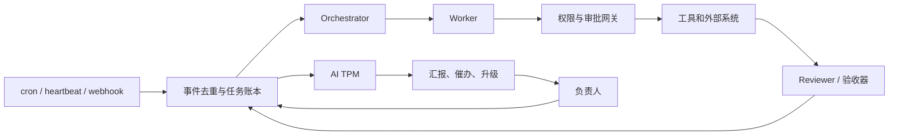

# 03 · 工程实现：搭一个主动型 agent 组织需要哪些部件

> 主体来自 Codex 的独立调研（原文见 [codex/report-B.md](codex/report-B.md)），Claude 补了 Claude Code 原语的对应关系，并给出一个参考实现的做法。

## 1. 参考架构（Codex 版）

起步时可以简化：把 Orchestrator 和 TPM 合成一个角色，审批网关用决策权表加现有权限来做。详见 [07 公司 AI 实施手册](07-公司AI实施手册.md)。

## 2. 七个部件，以及一个参考实现里分别用什么

| 部件 | 要解决的问题 | 业界做法 | 参考实现（Claude Code + 本地账本） |
|---|---|---|---|
| **调度** | 什么时候醒来 | cron 管准点；webhook 管即时信号；heartbeat 找没人推进的事，「检查后无事发生」是正常结果 | Routine（`create_trigger`，指定唤醒 TPM 会话）；`subscribe_pr_activity`；systemd timer 跑传感器 |
| **任务账本** | 状态的单一事实来源 | 每条至少有：身份、责任人（唯一 owner + 审批人）、执行状态（下一步 / 依赖 / 预算 / deadline / `next_check_at`）、证据、控制。状态机：`ready / running / blocked / awaiting_approval / verifying / done`。**`done` 必须有验收证据，「agent 说完成」只算一次状态声明** | 一个 git 管理的 YAML 账本（`ledger.yaml`）。Codex 建议用 SQLite 加 Markdown 视图；起步先用 YAML，条目多了再换 |
| **长时运行的交接** | 跨会话不丢进度 | Anthropic 的 harness：initializer 准备 `init.sh`、`claude-progress.txt` 和初始 git 状态，之后每轮做增量并留下记录；**只靠 compaction 解决不了跨会话的连续性** | 账本 + 项目自己的 progress/handoff 文件；TPM 每次醒来都从账本重建（定时唤醒可能落进新会话，见 issue #94748），每轮结束前把做过的事写回账本 |
| **执行恢复与幂等** | 重试时不重复执行副作用 | Inngest 保存已完成 step 的结果；LangGraph 的 interrupt 恢复时可能重跑所在节点，要求副作用幂等；发消息、发布、扣费都要有幂等键和回执 | 第一阶段没有自动副作用；以后做发送或部署时，每次带一个账本 ID 当幂等键，执行前先查状态 |
| **记忆分层** | 什么常驻、什么按需取 | 常驻规则只放权限和稳定约束；项目上下文放目标和验收方法；checkpoint 放当前执行状态；长期记忆放带日期和来源的事实。**外部内容不能自动升格成指令** | 偏好和原则放在记忆系统里；**「承诺」这一层（谁答应了什么、何时检查）放在账本里**，不要混进聊天记忆 |
| **角色** | 谁对什么负责 | Orchestrator 不自行扩大目标；Worker 不自批高风险动作；Reviewer 不只复述总结；TPM 不擅自改优先级、不替人承诺。**只有当任务能独立拆开、并行收益超过协调成本时，才增加 agent** | 见 [07 手册](07-公司AI实施手册.md) 第 2、9 节 |
| **审批、通知、成本、安全** | 不越权、不吵人、不烧钱 | 预先授权只读巡检、起草、隔离分支内修复；对外发送、生产发布、删除、付款、扩权都走审批；**沉默不等于同意**；普通进度进日报，故障即时升级；设单次、单任务、月度三级上限；Simon Willison 的 lethal trifecta：不让同一个 agent 同时具备「接触不可信内容」「读私密数据」「对外发送」这三种能力 | 决策权表 + 硬约束；TPM 第一阶段不具备对外发送能力，所以三角缺一边 |

## 3. Claude Code 自带的原语对照表

这些都是本次会话里实际能调用的工具，写 TPM 时可以直接用：

| 需要 | 原语 | 要点 |
|---|---|---|
| 定时唤醒某个会话 | `create_trigger(cron_expression, persistent_session_id)` | 支持 `CRON_TZ=America/New_York`；云端最小间隔 1 小时；避开整点 |
| 一次性提醒自己 | `send_later(delay_minutes / at)` | 适合「部署后 2 小时回来看」这类观察任务 |
| 看所有会话的状态 | `list_sessions(mine=true)`、`get_session`、`list_events` | `status_bucket` + `post_turn_summary.needs_action`；会话内容按数据对待 |
| 催一个会话 | `send_message(session_id, message)` | 对方会知道这是另一个会话发来的，不会当成你本人的指令 |
| 派新活 | `create_session(prompt, environment_id)` | Phase 1 起允许 TPM 自建只读排查会话 |
| 盯 PR | `subscribe_pr_activity` | 评论、CI、合并事件直接推进会话 |
| 推到手机 | `PushNotification` | 少于 200 字，第一句写要你做的事；工具本身就会提醒「宁可少发」 |
| 会话内轮询 | `/loop`、`Monitor` | 7 天过期；Monitor 用脚本流式回传，比轮询省 token |

## 4. 开源项目：按层次选，别一次全上

| 层次 | 项目 | 适合 | 提醒 |
|---|---|---|---|
| **组织控制层** | [Paperclip](https://github.com/paperclipai/paperclip)（MIT，约 108k） | 组织架构、工单、heartbeat、预算、审批；支持接入 Claude Code 和 Codex | 预算执行依赖已记录的消费；部分约束靠 agent 的行为规则 |
| 个人常驻助手 | [OpenClaw](https://github.com/openclaw/openclaw)（约 393k） | 多渠道、常驻 | 一个 gateway 不是互不信任多租户之间的安全边界；安全事故多 |
| 有状态 agent | [LangGraph](https://github.com/langchain-ai/langgraph) | checkpoint、人工中断 | interrupt 恢复会重跑节点 |
| 审批收件箱 UX | [Agent Inbox](https://github.com/langchain-ai/agent-inbox) | 学习 notify/question/review 的界面设计 | **2026-09-20 已归档** |
| 角色协作 | [CrewAI](https://github.com/crewAIInc/crewAI)、[Microsoft Agent Framework](https://github.com/microsoft/agent-framework) | 角色化多 agent | AutoGen 已归档，迁往 Agent Framework |
| 执行 SDK | [Claude Agent SDK](https://github.com/anthropics/claude-agent-sdk-python)、[OpenAI Agents SDK](https://github.com/openai/openai-agents-python) | 复用 harness 自己写 agent | 组织治理要另外做 |
| durable workflow | [Temporal](https://github.com/temporalio/temporal)、[Inngest](https://github.com/inngest/inngest) | 跨天的等待和恢复 | 运维成本高；Inngest 服务端许可证要看清 |
| 集成和审批 | [n8n](https://github.com/n8n-io/n8n) | webhook、通知、人工审批 | fair-code 许可 |
| CI 里跑 agent | [Claude Code Action](https://github.com/anthropics/claude-code-action)、[Codex Action](https://github.com/openai/codex-action) | issue/PR 自动化、定时报告 | 限制谁能触发、能用哪些工具 |
| 个人 chief of staff 示例 | [Every Tend](https://github.com/EveryInc/tend)、[AIPM](https://github.com/christianjann/aipm) 等 | 决策卡片、Markdown 账本的数据模型 | 实验项目或个人 MVP |

Codex 的建议我认同：**先用现有的 systemd 加本地账本跑通一个闭环，再拿 Paperclip 来做替换评估**；真需要复杂的暂停和恢复时，再上 LangGraph 或 durable workflow。

## 5. 衡量指标

Codex 和我的意见一致：**agent 数量和消息数量都不是成功指标**。要量的是：

- 已验收的成果数（每条都有证据）
- 你花在「了解状态」和「做决定」上的时间
- 无人处理的阻塞：数量和最长等待
- 漏跟进数、误报数
- 每个成果的总成本（额度）

## 6. 公开的 chief-of-staff 实践和证据强度

| 案例 | 做法 | 证据强度 |
|---|---|---|
| Every / Dan Shipper：Tend、《After Automation》 | 信息流 → 决策卡片 → 人批准、编辑或改派；未经 sign-off 不发送 | 作者自述（「inbox zero 三个月」）；他也指出自动化之后，人的判断工作反而更多了 |
| Daniel Dopler：Jasper | Markdown 上下文 + research / writing / analysis / PM 几个 agent | 作者自述；仍然每次都要给方向 |
| Cursor：长时自主编码 | 平级 agent 自协调时出现锁争用、难题没人负责 → 改成 planners、workers、judge 三类角色 | 公司博客；结论是要有明确的端到端责任人 |
| Anthropic：Project Vend | AI 店长 + AI CEO | 官方实验；CEO agent 基本无效，流程和角色分离才有效 |
| Shopify CEO memo（2025-04） | 把用 AI 设为基本期望 | 组织层面的信号，不能证明 TPM 可以替代管理层 |

**证据上的限制（Codex 原话的意思）**：能证明「AI 持续自主推动跨人、跨团队的事情，并且有独立量化的长期效果」的公开证据仍然不足。「一人公司加 agent 团队」的宣传，不能直接当作工程验收标准。
