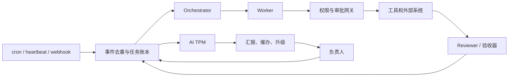

**主动型多 agent 组织：工程实现、开源选型与落地路线**

调研截止：**2026-10-27**。本报告为任务 B 的独立研究。事实优先引用官方文档、项目源码及实践者原文；“作者自述”不等于独立验证。滚动文档和仓库统一以本次查阅日期为准；无法确认的事项标为“未核实”。

**核心判断：用户 最值得先建设的是一个有任务账本、验收证据和升级机制的 AI TPM，再逐步增加执行 agent。**现有的 Claude Code、Codex、定时任务和已有流水线已经具备不少执行能力，主要缺口在于：谁持续负责、何时再次检查、什么证据算完成、遇到阻塞如何推动。

Paperclip 是本次找到的、与“管理一个 agent 组织”最贴近的开源候选；LangGraph、Agents SDK 和 Claude Agent SDK 更适合实现具体 agent；Temporal、Inngest 解决执行恢复；这些层次需要分别评估。[Paperclip README，查阅 2026-10-27](https://github.com/paperclipai/paperclip)、[LangGraph overview，查阅 2026-10-27](https://docs.langchain.com/oss/python/langgraph/overview)。

---

**一、工程架构：把主动性落实为可恢复的工作闭环。**

建议采用下列结构。图中属于本文方案，具体组件可以替换：

**调度应区分三种用途。**cron 负责固定时间工作，例如晨报、周报、部署后巡检；webhook 负责即时信号，例如 CI 失败、issue 更新、服务告警；heartbeat 周期性寻找无人推进、临近期限或需要复查的任务。heartbeat 应允许“检查后无事发生”，避免每次唤醒都生成新工作。

外部事件先进入持久队列，按 `event_id` 去重；同一任务设置并发租约、超时和退避。不要让每条通知直接启动一个无限循环。LangChain 的 ambient agents 正是围绕事件流响应，并区分 notify、question、review 三类人机交互。[Introducing ambient agents，2025-01-14](https://www.langchain.com/blog/introducing-ambient-agents)。

**任务账本是工作状态的单一事实来源。**建议每个任务至少包含：

| 类别 | 最小字段 |
|---|---|
| 身份 | `task_id`、所属组织、项目、目标 |
| 责任 | 唯一 owner、执行 agent、审批人 |
| 执行 | 状态、下一步、依赖、预算、deadline、`next_check_at` |
| 证据 | PR、产物、测试结果、部署版本、真实运行检查 |
| 控制 | 权限范围、审批记录、阻塞原因、变更历史 |

推荐状态包括 `ready / running / blocked / awaiting_approval / verifying / done`。`done` 必须有验收证据；“agent 说完成”只是一次状态声明。

个人阶段可用本地 SQLite 加 Markdown 展示；允许上云的公司项目可用 GitHub Issues/Projects。账本负责业务状态，workflow history 负责执行历史，二者用 ID 关联。若同时使用 Paperclip 和 GitHub，必须指定谁拥有状态写入权，避免双向同步形成两个权威来源。12-factor agents 对统一业务状态与执行状态、控制流程和暂停恢复提出了直接可借鉴的原则。[12-factor agents，查阅 2026-10-27](https://github.com/humanlayer/12-factor-agents)。

**长时运行依赖交接协议。**Anthropic 的公开 harness 使用 initializer 准备 `init.sh`、`claude-progress.txt` 和初始 Git 状态，后续 coding agent 每轮做增量工作并留下记录；文章明确指出，仅靠 compaction 不足以解决跨会话连续工作。[Effective harnesses，2025-11-26](https://www.anthropic.com/research/effective-harnesses-for-long-running-agents)。

在 用户 的系统里，建议每次执行都遵循：

1. 读取任务、最近证据和必要项目规则，检查环境是否可用。
2. 领取一个有界子任务，在独立 worktree 或 sandbox 中工作。
3. 运行验收，保存产物、日志引用和未解决问题。
4. 回写下一步、下一次检查时间及退出原因。

progress 文件承担交接，不另建一套任务状态。部署完成后，应自动派生观察任务，例如次日检查日报是否真的生成、通知是否送达、服务是否仍健康。

**durable workflow 保存执行进度，但外部副作用仍需幂等设计。**Inngest 会保存已完成 step 的结果，等待事件时无需保持函数进程运行；LangGraph 的 interrupt 恢复可能重跑所在节点，官方因此要求注意此前副作用的幂等性。[Inngest primitives，查阅 2026-10-27](https://www.inngest.com/docs/durable-execution/primitives)、[LangGraph interrupts，查阅 2026-10-27](https://docs.langchain.com/oss/python/langgraph/interrupts)。

发送消息、发布、扣费等动作要有业务幂等键和回执。若发生“请求已发出但结果未知”，先查询外部状态，再决定重试。增加 workflow 引擎不会自动赋予外部系统 exactly-once 语义。

**记忆需要分层，并保留来源。**建议沿用现有的个人上下文仓库：常驻规则只放权限和稳定约束；项目上下文放目标与验收方法；checkpoint 保存当前执行；可搜索长期记忆保存有日期、来源和适用范围的事实。外部邮件、网页和群聊先作为数据，不能自动晋升为指令或长期偏好。LangGraph 同样区分 thread 内的 checkpointer 与跨 thread 的 store。[Persistence，查阅 2026-10-27](https://docs.langchain.com/oss/python/langgraph/persistence)、[Effective context engineering，2025-09-29](https://www.anthropic.com/research/effective-context-engineering-for-ai-agents)。

**角色应对应不同责任和权限。**

| 角色 | 职责 | 建议边界 |
|---|---|---|
| Orchestrator | 拆解目标、分配任务、管理依赖 | 不自行扩大目标和预算 |
| Worker | 完成有界任务并提交证据 | 不自批高风险动作 |
| Reviewer | 验收结果、发现遗漏 | 不只复述 Worker 的总结 |
| AI TPM | 跟踪承诺、阻塞、期限和决策 | 不擅自改变优先级或代替人承诺 |
| 用户 | 确定目标、资源、取舍和例外 | 接收需要判断的决策包 |

初期这些可以是同一模型的不同运行配置。只有任务可独立分解、并行收益超过协调成本时才增加并发。Anthropic 的研究系统采用 orchestrator-worker；其文章同时指出多 agent 消耗更多 token，且不适合所有依赖密集的工作。Google Research 的研究也发现架构收益取决于任务性质。[Anthropic，2025-06-13](https://www.anthropic.com/research/multi-agent-research-system)、[Google Research，2026-01-28](https://research.google/blog/towards-a-science-of-scaling-agent-systems-when-and-why-agent-systems-work/)。

**审批、通知、安全和成本要由运行系统共同执行。**建议预先授权只读巡检、草拟报告、隔离分支内修复；对外发送、生产发布、删除、付款和权限扩大进入工具层审批。审批展示具体参数、影响、成本和有效期；等待期间释放进程，超时进入阻塞状态，不能把沉默当同意。OpenAI、LangGraph 和 n8n 均提供暂停等待人工决定的机制。[OpenAI human review，查阅 2026-10-27](https://developers.openai.com/api/docs/guides/agents/guardrails-approvals)、[n8n HITL，查阅 2026-10-27](https://docs.n8n.io/build/integrate-ai/ai-examples/human-in-the-loop-for-tools.md)。

通知按严重性分流：普通进度进入每日摘要；需要决策的事项进入待办；服务故障和越权事件即时升级。每条都附任务链接、证据、建议动作和最晚处理时间，并设置去重、静默时间及确认状态。

可观测性至少关联 `task_id → run_id → tool_call → artifact`，统计验收率、返工率、阻塞时长、漏检率、人工投入及每个完成任务的成本。OpenAI Agents SDK 内置 tracing；默认服务端路径会产生模型、工具、handoff 等记录，因此日志出网和敏感内容保留也必须纳入配置。[Integrations and observability，查阅 2026-10-27](https://developers.openai.com/api/docs/guides/agents/integrations-observability)。

成本控制应包含单次运行、任务和月度上限，限制工具调用、递归深度和并发；失败不能无限自我修复。安全上分离“接触不可信内容”“读取私密资料”“向外发送”三种能力，使用独立身份、目录、凭据范围和出网策略。Simon Willison 将三者同时存在称为 lethal trifecta。[原文，2025-06-16](https://simonwillison.net/2025/Jun/16/the-lethal-trifecta/)。

---

**二、开源项目：按承担的层次选型。**

下表 star 为 **2026-10-27 公开页面近似显示值**，不是成熟度评分。“成熟度判断”是本文工程判断，未进行安装或生产压测。未列出的最后 commit 日期均为**未核实**。

| 项目及 GitHub 来源 | 适合承担什么 | 成熟度与限制 |
|---|---|---|
| [Paperclip](https://github.com/paperclipai/paperclip)，约108k | 组织控制层：任务、层级、heartbeat、预算、审批、执行器适配 | 功能贴合需求，优先试点；不能据此认定可无人经营公司 |
| [OpenClaw](https://github.com/openclaw/openclaw)，约393k | 常驻个人助手、多渠道交互、主动任务 | 生态大、权限面广；需单独审核隔离及升级兼容性 |
| [LangGraph](https://github.com/langchain-ai/langgraph)，约44k | 有状态 agent、checkpoint、人工中断 | 适合明确状态机；组织账本和业务制度仍需设计 |
| [Agent Inbox](https://github.com/langchain-ai/agent-inbox)，约1.1k | 审批收件箱与 interrupt UX 参考 | **2026-09-20 已归档**，适合学习，不宜直接作为新系统主干 |
| [agents-from-scratch](https://github.com/langchain-ai/agents-from-scratch)，约2.4k | 带记忆和 HITL 的 email assistant 教程 | 教学参考，不是完整组织平台 |
| [CrewAI](https://github.com/crewAIInc/crewAI)，约60.2k | 用 Crews 表达角色协作，用 Flows 控制流程 | 上手方便；商业控制平台与开源核心须分别核对 |
| [Microsoft Agent Framework](https://github.com/microsoft/agent-framework)，约14.3k | Python/.NET agent、workflow、checkpoint、观测 | 当前微软主线；适合微软技术栈 |
| [AutoGen](https://github.com/microsoft/autogen) | 历史多 agent 模式与实验参考 | 当前 README 明确提示已归档、不再维护，建议迁往 Agent Framework |
| [OpenAI Agents SDK](https://github.com/openai/openai-agents-python)，约30.3k | 工具、handoff、sessions、guardrails、tracing | 官方执行 SDK；组织治理需另外建设 |
| [Claude Agent SDK](https://github.com/anthropics/claude-agent-sdk-python)，约8.4k | 复用 Claude Code 的工具和 agent harness | 与现有习惯衔接好；权限配置必须实测 |
| [Temporal](https://github.com/temporalio/temporal)，约24k | 跨小时或数日的流程、等待和恢复 | 通用 durable workflow 主干候选；运维复杂度较高 |
| [Inngest](https://github.com/inngest/inngest)，约6k | 事件触发、step 重试、sleep、等待事件 | 适合逐步引入 durable execution；服务端许可证须注意 |
| [n8n](https://github.com/n8n-io/n8n)，约209k | webhook、系统连接、通知和人工审批 | 适合公司运营集成；属于 fair-code/source-available |
| [Claude Code Action](https://github.com/anthropics/claude-code-action)，约9.7k | issue/PR 工作、定时巡检、报告及修复 | 官方 GitHub 接入路径；须限制触发者和工具权限 |
| [Codex Action](https://github.com/openai/codex-action)，约1.3k | GitHub 中执行 Codex、生成结构化产物 | 官方接入路径；runner 权限和 secret 隔离很关键 |
| [Every Tend](https://github.com/EveryInc/tend)，178 | 把邮件、Slack 等转换为决策卡片 | 官方明确为实验项目，无稳定性或持续支持保证 |
| [AIPM](https://github.com/christianjann/aipm)，0 | Jira/GitHub 汇总到本地 Markdown，生成计划与日报周报 | 小型个人项目，适合借鉴数据模型；长期可靠性未核实 |
| [TAI Chief](https://github.com/suhasbhairav/ai-chief-of-staff)，7 | 公司指标、OKR、任务和高管视图参考 | 作者明确标为个人 MVP，生产效果未核实 |
| [Local chief-of-staff](https://github.com/xaviervasques/chief-of-staff)，18 | Granite、LangGraph 的本地多 agent 示例 | 仓库规模小，适合概念验证；部署效果未核实 |

活跃度补充：本次 release 页面显示 Paperclip 最新条目为 `v2026.1023.0`；LangGraph `1.2.18` 于 10 月 26 日发布；Microsoft Agent Framework `.NET 1.26.0` 于 10 月 23 日发布。release 活跃不代表具体集成已稳定。[Paperclip releases](https://github.com/paperclipai/paperclip/releases)、[LangGraph releases](https://github.com/langchain-ai/langgraph/releases)、[MAF releases](https://github.com/microsoft/agent-framework/releases)，查阅 2026-10-27。

有四个容易被旧教程掩盖的边界：

- Paperclip 的预算执行依赖已记录消费，进行中的调用和上报延迟可能造成超支；其花费审批教程也明确说，系统不会自动识别任意代码即将花钱，部分约束依赖 agent playbook。[审批文档，查阅 2026-10-27](https://docs.paperclip.ing/how-to/require-board-approval-before-spend/)。
- OpenClaw 官方说明，一个 gateway 不是不互信多租户之间的安全边界；不同信任域应拆开 gateway、凭据，最好也拆 OS 用户或主机。[Security，查阅 2026-10-27](https://docs.openclaw.ai/gateway/security)。
- OpenClaw `2026.8.1` 文档说明 heartbeat 已迁往 Automations，旧 `HEARTBEAT.md` 不再直接作为运行输入，不能照抄早期教程。[版本文档，查阅 2026-10-27](https://docs.openclaw.ai/releases/2026.8.1/automations-and-scheduling)。
- n8n 使用 Sustainable Use/Enterprise License；Inngest 当前服务端许可证包含 SSPL 与未来 Apache 授权安排。不能把“源码可见、自托管”直接理解为任意商业托管都获授权。[n8n 仓库](https://github.com/n8n-io/n8n)、[Inngest LICENSE](https://github.com/inngest/inngest/blob/main/LICENSE.md)，查阅 2026-10-27。

本文建议：先用现有 systemd 加本地账本完成一个闭环，再对照 Paperclip 做替换评估；需要复杂暂停恢复时，选择 LangGraph 或 durable workflow。不要一开始同时叠加全部框架。

---

**三、AI TPM / chief of staff：最有价值的产物是待决策事项。**

建议把这个角色定义为“维护承诺和推进节奏的系统”，具体覆盖：

| 工作 | 应交付什么 |
|---|---|
| 每日 standup | 昨日已验收结果、今日下一步、阻塞、需要谁决定 |
| 进度追踪 | 实际证据与计划差异，标出长期无变化任务 |
| 阻塞识别 | 区分权限、依赖、技术故障和待用户输入 |
| 催办 | 指明承诺、期限和影响，允许延期、取消、重排 |
| 周报 | 完成目标、返工、成本、失败原因和下周取舍 |
| OKR 跟踪 | 将任务证据关联结果指标，避免用活动量代替成果 |

允许 TPM push 用户，应预先约定范围：可提醒哪些承诺、多久升级、何时静默。好的提醒是：“A 因缺少决定 B 已停两天；建议选 C，依据如下；请在周五前决定。”如果目标本身已失去价值，TPM 应建议关闭它。

公开实践提供了几种不同证据：

**Every / Dan Shipper。**Tend 将信息流整理成摘要、回复草稿或下一步卡片，由人批准、编辑或重定向，官方说明未经 sign-off 不发送；页面声称 Dan 已保持 inbox zero 三个月，属于作者自述。Dan 在《After Automation》中另称 AI 回复了其大部分工作邮件，但他仍审核，并观察到自动化后人的判断工作增加。可借鉴的是决策集中、反馈回写和人工控制，不能据此推导组织可以无人运行。[Tend，查阅 2026-10-27](https://every.to/tend)、[After Automation，2026-05-21](https://every.to/p/after-automation)。

**Daniel Dopler / Jasper。**其公开 setup 包含 Markdown 上下文、research/writing/analysis/project-management agent 和文件产物。他自述搭建约六小时，写作由三小时降到四十五分钟；这些收益无独立验证，而且仍需每次给方向，不能算已证明的全天自主 TPM。[原文，2026-02-20](https://www.danieldopler.com/blog/building-jasper-my-ai-chief-of-staff)。

**Cursor。**其长期编码实验中，平级 agent 自协调出现锁争用、无人负责难题等问题，之后分为 planners、workers 和 judge。对组织设计的启示是明确端到端责任；实验规模和代码量不能等同于可维护的业务成果。[原文，2026-01-14](https://cursor.com/blog/scaling-agents)。

**Shopify。**2025-04-07 CEO memo 将 AI 使用列为基本期望；公司后续公开分享工具普及、实验平台和内部学习机制。这支持“领导者改变资源配置与工作方式”的讨论，但不是 AI TPM 已替代管理层的证据。[公司原文，2025-10-28，含 memo 链接](https://www.shopify.com/news/unserious-exploration)。

**证据限制：**本次找到的 chief of staff 案例，多为作者自述、产品实验或参考实现。能够持续自主推动跨人、跨团队事项，并有独立量化长期效果的公开证据仍不足。“一人公司加 agent 团队”的宣传不能直接当作工程验收标准。

---

**四、从个人系统到小公司的分阶段路线。**

以下时间和成功阈值均为本文建议，不是行业事实。

| 阶段 | 建设内容 | 成功标准 |
|---|---|---|
| 第0阶段：约1周 | 盘点服务、owner、权限、预算和健康检查；选一条已有的定时流水线试点 | 能回答每个试点任务何时运行、产物在哪、失败谁处理；取得人工管理时间基线 |
| 第1阶段：约2周 | 只读 AI TPM，定时扫描本地状态并汇总阻塞 | 连续14天报告均可追溯；故障演练不漏报；无需用户反复询问进度 |
| 第2阶段：约2—4周 | 接入一个 Worker 和 Reviewer；允许隔离修复，发布仍审批 | 至少20个有代表性的任务完成验收；断电重启可恢复；无重复副作用或越权 |
| 第3阶段：约1—2月 | 多项目账本、依赖、决策卡片、周报；试用 Paperclip | 管理时间较基线下降至少30%；验收质量不下降；遗漏和无效催办可统计 |
| 第4阶段：扩展小公司 | 每个 agent 有身份、权限和责任人；接入正式 issue tracker；按需求引入 durable workflow | 权限可撤销、数据可导出、备份可恢复；单个 agent 失控不扩散；成本能归到业务结果 |

第一个闭环可以定义为：“某条定时报告未在约定时间出现 → TPM 检查 → 建立故障任务 → Worker 准备修复 → Reviewer 验证 → 必要时请求发布审批 → 次日确认恢复”。先验证这一闭环，再扩展到公司项目跟踪和客户交付。

最终应持续衡量：**已验收成果、人工决策时间、无人处理的阻塞、每个成果的总成本**。agent 数量和消息数量不宜作为成功指标。

---

**完整来源与阅读清单。**

下列 **35 项文章、教程与文档**同时构成阅读路线。标注“查阅”的滚动页面，其首次发布日期未核实。阶段：入门＝确定边界；试点＝实现首个闭环；生产＝恢复、安全和评测；组织＝扩展公司工作方式。

1. [Anthropic — Building effective agents](https://www.anthropic.com/research/building-effective-agents)，**2024-12-19**。入门：理解 workflow、agent 和常用组合模式。
2. [OpenAI — A practical guide to building agents](https://openai.com/business/guides-and-resources/a-practical-guide-to-building-ai-agents/)，**当前 HTML 页面标注 2026-01-15**。入门：系统梳理模型、工具、指令和 guardrails；此日期不代表历史 PDF 首发。
3. [LangChain — Introducing ambient agents](https://www.langchain.com/blog/introducing-ambient-agents)，**2025-01-14**。入门：建立事件驱动及 notify/question/review 的交互设计。
4. [HumanLayer — 12-factor agents](https://github.com/humanlayer/12-factor-agents)，**查阅 2026-10-27**。试点：重点阅读状态统一、暂停恢复、控制流程和小型 agent。
5. [Anthropic — How we built our multi-agent research system](https://www.anthropic.com/research/multi-agent-research-system)，**2025-06-13**。试点：学习委派边界、资源分配和协调代价。
6. [Anthropic — Effective harnesses for long-running agents](https://www.anthropic.com/research/effective-harnesses-for-long-running-agents)，**2025-11-26**。试点：直接参考初始化、进度交接和增量验收。
7. [Anthropic — Effective context engineering for AI agents](https://www.anthropic.com/research/effective-context-engineering-for-ai-agents)，**2025-09-29**。试点：设计按需加载和有限上下文预算。
8. [Anthropic — Writing effective tools for agents—with agents](https://www.anthropic.com/research/writing-tools-for-agents)，**2025-09-11**。试点：提高工具边界、返回信息及调用可靠性。
9. [Anthropic — Building agents with the Claude Agent SDK](https://claude.com/resources/articles/building-agents-with-the-claude-agent-sdk)，**2025-09-29**。试点：了解如何复用 Claude Code harness。
10. [Anthropic — Demystifying evals for AI agents](https://www.anthropic.com/research/demystifying-evals-for-ai-agents)，**2026-01-09**。生产：把“看起来成功”转为可重复评估。
11. [Anthropic — Harness design for long-running application development](https://www.anthropic.com/research/harness-design-long-running-apps)，**2026-03-24**。生产：学习 generator/evaluator 分工和质量标准。
12. [Cursor — Scaling long-running autonomous coding](https://cursor.com/blog/scaling-agents)，**2026-01-14**。生产：理解平级协调失败与角色分工。
13. [Google Research — Towards a science of scaling agent systems](https://research.google/blog/towards-a-science-of-scaling-agent-systems-when-and-why-agent-systems-work/)，**2026-01-28**。生产：判断何时多 agent 有益、何时增加负担。
14. [Simon Willison — The lethal trifecta for AI agents](https://simonwillison.net/2025/Jun/16/the-lethal-trifecta/)，**2025-06-16**。入门：设计私密数据、外部内容与发送能力的隔离。
15. [Latent Space — Agent Engineering](https://latent.space/p/agent/)，**2025-03-24**。入门：建立涵盖模型、工具、记忆及运行环境的概念地图。
16. [LangGraph — Overview](https://docs.langchain.com/oss/python/langgraph/overview)，**查阅 2026-10-27**。试点：理解状态图与确定性步骤如何组合。
17. [LangGraph — Persistence](https://docs.langchain.com/oss/python/langgraph/persistence)，**查阅 2026-10-27**。试点：区分 thread checkpoint 与长期 store。
18. [LangGraph — Interrupts](https://docs.langchain.com/oss/python/langgraph/interrupts)，**查阅 2026-10-27**。生产：掌握人工暂停、恢复和副作用重跑问题。
19. [Temporal — Workflows](https://docs.temporal.io/workflows)，**查阅 2026-10-27**。生产：建立 durable workflow 的执行模型。
20. [Inngest — Primitives and steps](https://www.inngest.com/docs/durable-execution/primitives)，**查阅 2026-10-27**。试点：实现 step 保存、重试、sleep 和事件等待。
21. [n8n — Human-in-the-loop for tools](https://docs.n8n.io/build/integrate-ai/ai-examples/human-in-the-loop-for-tools.md)，**查阅 2026-10-27**。试点：学习具体工具调用前的审批流程。
22. [Claude Code — GitHub Actions](https://code.claude.com/docs/en/github-actions)，**查阅 2026-10-27**。试点：接入定时报告、issue 和 PR 自动化。
23. [OpenAI — Codex GitHub Action](https://learn.chatgpt.com/docs/github-action)，**查阅 2026-10-27**。试点：了解 Codex CI 接入、结构化输出和 runner 安全。
24. [OpenAI — Integrations and observability](https://developers.openai.com/api/docs/guides/agents/integrations-observability)，**查阅 2026-10-27**。生产：建立工具、handoff 和运行 tracing。
25. [OpenAI — Guardrails and human review](https://developers.openai.com/api/docs/guides/agents/guardrails-approvals)，**查阅 2026-10-27**。生产：区分自动校验与人工批准。
26. [McKinsey — The agentic organization](https://www.mckinsey.com/capabilities/people-and-organization/our-insights/the-agentic-organization-contours-of-the-next-paradigm-for-the-ai-era)，**2025-09-26**。组织：讨论流程、治理及领导责任；作为观点框架阅读。
27. [Shopify — Serious results, unserious methods](https://www.shopify.com/news/unserious-exploration)，**2025-10-28**。组织：阅读 CEO memo 与公司配套的实验、工具和分享机制。
28. [Daniel Dopler — Building Jasper: My AI Chief of Staff](https://www.danieldopler.com/blog/building-jasper-my-ai-chief-of-staff)，**2026-02-20**。试点：参考个人上下文、角色分工和文件产物；收益属作者自述。
29. [Dan Shipper — After Automation](https://every.to/p/after-automation)，**2026-05-21**。组织：理解自动化后仍需承担的审核与判断工作。
30. [Every — Tend](https://every.to/tend)，**查阅 2026-10-27**。试点：参考决策卡片、批准、执行和反馈闭环。
31. [Paperclip — Require Board Approval Before Spend](https://docs.paperclip.ing/how-to/require-board-approval-before-spend/)，**查阅 2026-10-27**。生产：识别预算上限、行为规则与强制拦截的差别。
32. [OpenClaw — Security](https://docs.openclaw.ai/gateway/security)，**查阅 2026-10-27**。生产：明确 gateway 信任边界与多用户限制。
33. [OpenClaw — v2026.8.1 Automations and Scheduling](https://docs.openclaw.ai/releases/2026.8.1/automations-and-scheduling)，**查阅 2026-10-27**。迁移：核对 heartbeat、恢复和旧配置变化。
34. [Inngest — LICENSE](https://github.com/inngest/inngest/blob/main/LICENSE.md)，**查阅 2026-10-27**。选型：核对服务端许可及未来授权条件。
35. [n8n — README / License](https://github.com/n8n-io/n8n)，**查阅 2026-10-27**。选型：确认 fair-code 和自托管能力的授权边界。

仓库与维护状态的完整原始来源，均查阅于 **2026-10-27**：

- 组织与个人助手：[Paperclip](https://github.com/paperclipai/paperclip)、[OpenClaw](https://github.com/openclaw/openclaw)、[Tend](https://github.com/EveryInc/tend)、[AIPM](https://github.com/christianjann/aipm)、[TAI Chief](https://github.com/suhasbhairav/ai-chief-of-staff)、[Local chief-of-staff](https://github.com/xaviervasques/chief-of-staff)。
- Agent 框架：[LangGraph](https://github.com/langchain-ai/langgraph)、[Agent Inbox](https://github.com/langchain-ai/agent-inbox)、[agents-from-scratch](https://github.com/langchain-ai/agents-from-scratch)、[CrewAI](https://github.com/crewAIInc/crewAI)、[Microsoft Agent Framework](https://github.com/microsoft/agent-framework)、[AutoGen](https://github.com/microsoft/autogen)、[OpenAI Agents SDK](https://github.com/openai/openai-agents-python)、[Claude Agent SDK](https://github.com/anthropics/claude-agent-sdk-python)。
- 执行与集成：[Temporal](https://github.com/temporalio/temporal)、[Inngest](https://github.com/inngest/inngest)、[n8n](https://github.com/n8n-io/n8n)、[Claude Code Action](https://github.com/anthropics/claude-code-action)、[Codex Action](https://github.com/openai/codex-action)。
- Release 核对：[Paperclip](https://github.com/paperclipai/paperclip/releases)、[LangGraph](https://github.com/langchain-ai/langgraph/releases)、[Microsoft Agent Framework](https://github.com/microsoft/agent-framework/releases)。

